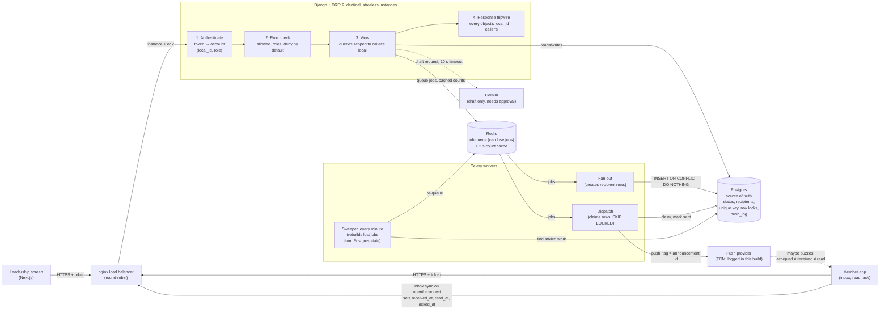

# CrewLink — Member Callout: Design

## Part 0 · Requirements

### What we're building (explained back to Denise)

When leadership sends a callout, every active member of that local (or just one classification, like apprentices) gets it. Members who are offline won't miss it: the message waits in their app and shows up the moment their phone reconnects, with a push notification as a nudge. Members can mark it as seen, acknowledge it, and say whether they're coming. Before you leave the hall, a live screen shows who has seen it, who acknowledged, and who said they're coming. Nobody outside your local can see your local's callouts or members.

### Assumptions

- **Who it's for.** Each leader and each member belongs to exactly one local. Only leaders can send callouts and see the status screen. Members can only read and respond to callouts sent to them. Retired and suspended members are not included in callouts.
- **Meetings have a time, and they expire.** A meeting callout has an event time. Once it passes, no more pushes go out for it, and the member's app shows "this meeting has already happened" instead of a normal alert. Before the event, the status screen highlights members who still haven't seen it, so leadership can call them while there's still time. Expiry doesn't make delivery faster, but it stops a late message from misleading anyone.
- **What "immediately" means.** Pressing Send responds in under a second. Pushes to even the largest local (22,400) go out within about 2 minutes. For members who are offline, the callout waits in their inbox. Push is a nudge, not the guarantee: a push accepted by the provider is not proof the member got it, and only the app opening it proves they read it.
- **Acknowledging and attendance.** Acknowledging is optional per callout (the `needs_ack` flag). "Coming / can't come" applies only to meetings. A member counts as "can't come" only if they actually choose it. Everyone else is **no response**, split into "hasn't seen it yet" (needs a call) and "seen, no reply" (needs a reminder). Silence is never counted as "not coming."
- **No edits after send.** A correction, including a moved meeting time, is sent as a new callout that links to the original, so members are actually told about the change.
- **The audience is fixed at send time.** Members who join, or change classification, after Send don't receive that callout.
- **What counts as done.** Leaders can see each member's status, no member ever gets the same callout twice, and no data crosses between locals.

### Concerns

1. **There may be a data leak already, and it should be checked and fixed as a separate incident before new features ship.** Denise asks whether members from other locals can see the wireman apprentices' contact info because "someone mentioned it." If that's true, Rule 1 is already broken in today's system, and exposed union membership can cost people their jobs. The check means reviewing the onboarding and member directory endpoints and their access logs. Our callout API never returns other members' contact details, even inside the same local.
2. **"Got it too late" can't be fully fixed by push.** About 5–10% of pushes fail silently, and members can be offline for days. We shouldn't promise that every phone buzzes on time. What we can promise is that the message is always waiting, and that leadership can see exactly who hasn't seen it yet, so they can follow up.
3. **There's no real deadline.** "Before contract talks, whenever" invites rushed scope. Proposal: ship send, inbox, read/acknowledge and the status screen first; attendance and SMS follow-up next.

### Questions for Denise (and what we assumed instead)

1. **What exactly was said at onboarding about apprentice contact info, and by whom?**
   *Assumed:* it's a possible breach. Flag it for investigation and build nothing that exposes contact details.
2. **On callout day, do you need "coming / can't come," or is "seen it" enough? Is no reply acceptable?**
   *Assumed:* acknowledging is optional per callout, attendance is for meetings only, and no reply is shown separately.
3. **How fast is fast enough, and should people who haven't seen an urgent callout get a text after some time?**
   *Assumed:* a few minutes is fine. An SMS follow-up for unacknowledged urgent callouts is a later step, not part of this build.

---

## Part A · Design

### 1. Data model

`locals` and `members` stay as given.

**`accounts`**: who can log in, and with what powers
- `user_id` (1:1 with the Django user), `local_id`, `role` (`leader` | `member`), `member_id` (required when role is member; enforced by a DB check)
- *Rejected:* a `role` column on `members` (not every leader is a member, and it mixes login with union membership). Django Groups (no notion of a local, so the local check would live somewhere else).

**`announcements`**: the brief's fields, plus
- `status`: `draft → approved → queued → sending → sent`. Rule 2's send guard is a conditional change on this field.
- `kind` (`general` | `meeting`), `event_at` (meeting time, used for expiry), `audience_classification` (optional filter)
- `push_preview` (≤120 chars, DB check), `created_by`, `approved_by`, `approved_at` (no approval, no send), `supersedes_id` (a correction links to the original)
- `version`: bumped by every edit, and any edit clears approval. Approve must name the version the leader reviewed (else 409), so nobody approves text they never saw.

**`announcement_recipients`**: one row per member per callout. This is both the audience snapshot and the delivery record.
- `announcement_id`, `member_id`: **unique together** (the foundation of Rule 2)
- `local_id` (copied in, for fast scoped queries), `push_status` (`pending | sending | sent | failed | skipped`), `push_attempts`
- `sent_at` (push **accepted by the provider**, not proof the phone got it), `received_at` (the member's app synced it into the inbox: the first proof it reached the phone), `read_at`, `acked_at`, `rsvp` (`NULL | coming | cant`), `rsvp_at`
- The status screen shows these separately: sent, on device, read, acknowledged.

**Why timestamps, not one status field:** they keep *when* things happened, so "hasn't seen it" (`read_at` empty) and "seen, no reply" (`read_at` set, `rsvp` empty) fall straight out of the data. Acking sets `read_at` if it's empty. A repeat ack keeps the first time. RSVP can change until `event_at`. A read after expiry is still recorded.

**Cross-local guarantee (built):** composite foreign keys make Postgres itself refuse a recipient row whose local differs from its announcement's `(announcement_id, local_id)` or its member's `(member_id, local_id)`, and an account whose `(member_id, local_id)` points at another local's member. They're raw SQL in migrations because Django can't express composite FKs; `Account.clean()` stays only for a friendly error message.

### 2. The send path

**Inside the request (leader waits ~100 ms):**
1. Check the caller is a leader of this announcement's local (otherwise 404), and that the announcement is approved.
2. One atomic update: `UPDATE announcements SET status='queued', sent_at=now() WHERE id=? AND status='approved'`. One row changed means a first send. Zero rows means a retry or a double click, so we return the same 202 and do no new work (or 409 if it was never approved). Doing the check and the change in one statement avoids a check-then-act race between two leaders clicking at once.
3. Queue the fan-out job with `transaction.on_commit`, so the worker never runs before the status change is saved. Return **202 Accepted**; the screen switches to live counts.

**Elsewhere (Celery workers):**
4. **Fan-out:** one `INSERT … SELECT` of active members in the local (plus classification), `ON CONFLICT (announcement_id, member_id) DO NOTHING`. It runs only while `queued`, and the insert and the switch to `sending` share one transaction, so a re-run can't add members who joined after Send. Dispatch works in batches of 500.
5. **Dispatch:** each job claims rows with `UPDATE … SET push_status='sending' WHERE id IN (SELECT … WHERE push_status='pending' LIMIT 500 FOR UPDATE SKIP LOCKED)`, so parallel workers, even on different instances, never get the same row.
6. Past `event_at`, or if the member was suspended after Send, the row is marked `skipped` and nothing is pushed. Otherwise the push goes out and the row becomes `sent` (accepted by the provider; the phone may still be offline). Failures retry after 30 s (3 tries), then `failed`; the message is still in the inbox.
7. When nothing is `pending` or `sending`, the announcement is `sent`. With 4 workers, the largest local finishes in under 2 minutes.

**Members** sync `GET /me/announcements` on app open and reconnect, so offline members miss nothing; push is only a nudge.

**If Redis loses jobs:** a crash or restart can lose them, which is safe because jobs are only messengers; the work still to do is in Postgres. A sweeper (Celery beat, every minute) re-queues stalled work: announcements `queued` over a minute (fan-out lost), `sending` with `pending` rows untouched for 2 minutes (dispatch lost), and rows in `sending` over 5 minutes (worker died; reset to `pending`). Workers use `acks_late`, so a crashed job returns to the queue. Re-queuing a job that wasn't really lost is harmless, because every step is idempotent. Without Redis at all, `manage.py process_sends` polls Postgres and runs the same steps: Redis adds speed, not correctness.

**Live counts without hammering the DB:** the screen polls `GET /announcements/{id}/stats` every 3 s. The server serves it from Redis (2 s expiry); on a miss it runs one `COUNT(*) FILTER (…)` query on the indexed recipient rows. Any number of viewers means at most one query per 2 s per announcement.
- *Rejected:* per-push counter columns (22,400 updates fighting over one row lock); WebSockets/SSE (more infrastructure than a 3 s delay justifies).

### 3. The two rules, by design

**Rule 1: two boundaries, enforced in one place**
- **Identity comes from the server.** The login token loads the user's `account` (`local_id`, `role`). A `local_id` in the URL or body is ignored, and new records take `local_id` from the caller's account.
- **Between locals:** every view inherits `LocalScopedMixin`, whose `get_queryset` filters by the caller's `local_id`. Another local's record is simply not found, so the response is **404**, which doesn't confirm it exists.
- **Member vs leader:** each view declares `allowed_roles`. Members also only see their own recipient rows. A member calling a leader endpoint gets **403** (nothing new is revealed inside their own local).
- **Responses:** serializers never return other members' contact details.
- **The endpoint added next year:** the default permission denies everyone unless a view declares `allowed_roles`, so a forgotten role setting fails closed at runtime. A guard test walks every URL and fails the build if a view doesn't inherit the scoped base (or isn't on a short reviewed allow-list, such as login). This catches a forgotten local filter that the role check alone would miss.
- **Known limit:** a raw unscoped query inside a scoped view gets past both. Next: Postgres Row-Level Security keyed on `local_id`.

**Rule 2: one guard at each moment a duplicate could appear, all in Postgres**
- **Send pressed twice** (double click, retry, two leaders): the atomic `approved → queued` update succeeds once; later attempts change 0 rows and get the same 202.
- **Fan-out restarts:** `UNIQUE (announcement_id, member_id)` with `ON CONFLICT DO NOTHING`; re-running inserts only missing rows.
- **Dispatch in parallel or restarted:** rows are claimed with `FOR UPDATE SKIP LOCKED` and only `pending` rows are pushed. The lock plus the status check gives correctness; `SKIP LOCKED` gives parallel speed.
- **Why not in memory:** a "sent" set in one process dies with a restart and is invisible to a second instance. Postgres is shared by all.
- **The gap we can't close:** a crash between "push accepted" and "saved as sent" leaves the row in `sending`; the sweeper resets it and it is pushed again. Pushing and writing to the DB can't be one atomic step, so delivery is at-least-once, and we make repeats harmless on the device: each push carries the **announcement id** as its Android notification `tag` and iOS `apns-collapse-id`, so a repeat of the same callout replaces the notification already shown, while different callouts never replace each other. The inbox is also keyed by announcement id. (Not FCM's `collapse_key`: notification messages ignore it.)

**Finding out in production that a rule already broke:** each rule is written as an invariant (a query that must return zero rows), checked live and on a schedule.
- **Rule 1 tripwire:** the base serializer checks every object's `local_id` against the caller's before a response leaves; a mismatch is blocked, logged and alerted. This catches the raw-query case prevention misses.
- **Rule 1 audits:** queries for recipient rows whose `local_id` differs from their announcement's or member's, and member accounts linked to another local's member. Next: a per-request audit log, alerting on many 404/403s from one account (id probing).
- **Rule 2:** an intent row goes into `push_log` *before* each push (`ok = NULL`, outcome unknown) and is completed after, so a crash mid-push still records who may have been pushed. (A `kill -9` test showed logging only after the batch recorded nothing.) Alert when any recipient has more than one possible push; sweeper resets are logged as possible duplicates.
- **Built:** `manage.py check_integrity` runs these invariants and exits 1 on any failure, ready for a nightly job.
- **If one fires:** contain first, measure exposure both ways (who saw what), find the cause in the audit log, inform both locals' leadership, then fix with a test that reproduces it.

### 4. Diagram

API instances keep no state of their own, so nginx can send any request to either one. Everything that must survive a restart or be shared lives in Postgres; Redis can lose jobs and the sweeper rebuilds them from Postgres.

---

## What I cut

Designed above, not built in this submission:

- **RSVP endpoints** ("coming / can't come"). The fields exist on `announcement_recipients` and the status screen counts them, but members have no endpoint to set them yet.
- **A member-facing screen.** Members use the API (`/api/me/announcements`, read, ack); the brief's frontend is the leadership screen.
- **Real push (FCM/APNs)** and the **SMS follow-up** for unacknowledged urgent callouts. Push goes through a logging provider with an optional simulated failure rate.
- **A "who hasn't seen it" member list** on the status screen. Only the counts are built.
- **Postgres Row-Level Security** as a third Rule 1 layer, and the **per-request audit log**.
- **`httpOnly` cookie auth.** The leadership screen keeps its token in `sessionStorage`, which is simpler but readable by any injected script.
- **A circuit breaker for Gemini.** Each call has a hard 10 s timeout and no retries, but repeated failures aren't short-circuited.
- **Server-Sent Events** for live counts. The screen polls every 3 s (10 s once sent) against a 2 s cache.
